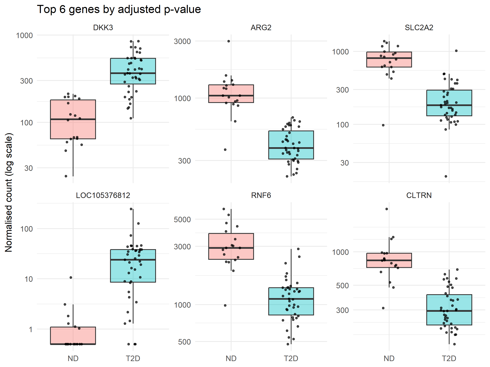

# Differential gene expression in pancreatic islets: type 2 diabetes vs non-diabetic donors

A reproducible R/Bioconductor reanalysis of public RNA-seq data from human pancreatic islets, comparing people with type 2 diabetes (T2D) to non-diabetic (ND) people.

**Question:** Which genes are expressed at different levels in islets from people with type 2 diabetes compared with non-diabetic people?

**Tools:** R, Bioconductor (DESeq2, GEOquery, apeglm), ggplot2, pheatmap, Git/GitHub

## Key findings

- **2,954 genes** differed between T2D and ND islets (FDR < 0.05): 1,638 higher and 1,316 lower in T2D.
- Genes involved in **beta-cell function**, such as **ARG2** and **SLC2A2** (the GLUT2 glucose transporter), were modestly but **consistently lower in T2D** across patients.
- A second group, including **immunoglobulin and inflammation-related genes**, was much higher in **a subset of T2D patients**, suggesting immune cells or inflammation in some samples rather than a change shared by all patients.
- **14 of 19 genes** in a published T2D islet signature were significant here, all in the same direction, and none went the opposite way.

## Data

- **Source:** NCBI GEO series [GSE164416](https://www.ncbi.nlm.nih.gov/geo/query/acc.cgi?acc=GSE164416), from Wigger L, Barovic M, Brunner AD, et al. *Multi-omics profiling of living human pancreatic islet donors reveals heterogeneous beta cell trajectories towards type 2 diabetes.* Nature Metabolism 3, 1017–1031 (2021). https://doi.org/10.1038/s42255-021-00420-9
- **Samples:** islets cut out by laser capture microdissection from pancreas tissue removed during surgery in 133 living patients.
- **Counts:** raw gene counts generated by NCBI's standard pipeline (alignment to GRCh38, counting with featureCounts). I did not align reads myself.
- **Sample information available on GEO:** diabetes status, library preparation date, and the authors' filtered-subset flag. Sex, age and BMI were not available.
- **Samples used:** 18 ND and 39 T2D (57 in total). I excluded the 76 samples from other groups (38 impaired glucose tolerance, 35 type 3c diabetes, 3 impaired fasting glucose) to keep a clear two-group comparison. Details: `results/analysis_log.txt` and `results/tables/samples_used.csv`.

| Library preparation date | ND | T2D |
|---|---|---|
| 26/02/2013 | 0 | 2 |
| 16/01/2014 | 4 | 2 |
| 27/03/2014 | 3 | 13 |
| 30/06/2014 | 3 | 5 |
| 24/07/2015 | 8 | 16 |
| 24/11/2016 | 0 | 1 |
| **Total** | **18** | **39** |

## Methods

1. **Download and checks** (`01_download_data.R`): downloaded counts, gene annotation and sample information from GEO. As a sanity check, insulin (INS) was among the most highly expressed genes in every sample (about 440,000 to 1.5 million reads), confirming the samples are islet tissue.
2. **Data preparation** (`02_prepare_data.R`): matched sample information to count columns using GEO sample IDs; kept genes with at least 10 reads in at least 18 samples (19,396 of 39,376 genes kept).
3. **Quality checks** (`03_quality_checks.R`): library sizes (4.4 to 39.5 million reads, median 22.2 million), variance-stabilising transformation, PCA of the 500 most variable genes, and a sample-to-sample distance heatmap. No samples were removed (see Quality checks below).
4. **Differential expression** (`04_differential_expression.R`): DESeq2 negative binomial model with design `~ batch + condition`, where batch is the library preparation date. The T2D vs ND effect was tested with a Wald test; p-values were adjusted with the Benjamini–Hochberg method, and genes with adjusted p < 0.05 were called significant. Log2 fold changes were shrunk with apeglm for ranking and plotting.
5. **Figures** (`05_figures.R`): p-value histogram, MA plot, volcano plot, heatmap of the top 30 genes, and per-patient counts for the top 6 genes.

## Quality checks


- ND and T2D samples did not separate clearly on the PCA, and T2D samples were more spread out, consistent with the original paper's report that T2D islets are more heterogeneous.
- Samples did not group by library preparation date, so there was no strong batch effect; batch was kept in the model as a precaution.
- Four samples (2 ND, 2 T2D) had under a quarter of the median read count. Because they were spread across both groups and DESeq2 corrects for sequencing depth, I kept them.
- PC1 (45% of variance) was moderately linked to insulin content (correlation −0.35). Two T2D samples had very little insulin (about 0.5% of reads, against a typical 5%) with normal sequencing depth. I could not tell whether this was technical (little islet tissue in the sample) or biological (beta-cell loss), so I kept them and checked that the top results did not depend on them.

## Results


Of 19,396 genes tested, 2,954 were significant at FDR < 0.05 (1,638 higher and 1,316 lower in T2D), and 401 of these changed at least two-fold.


Two patterns stood out among the top genes:

- **Lower in T2D, consistently across patients:** genes linked to beta-cell function, including ARG2 (the 2nd most significant gene) and SLC2A2, which encodes GLUT2, the transporter beta cells use to take in glucose.
- **Higher in T2D, mainly in a subset of patients:** immunoglobulin genes (e.g. IGHG1, IGKC) and inflammation-related genes (e.g. SAA1). These are not made by islet cells, which suggests immune cells or inflammation in some samples.



Per-patient plots confirmed that the top genes differ across most patients, not just a few. One exception to treat with caution is LOC105376812, an uncharacterised gene: it shows a very large fold change because it is almost absent in ND samples, but its overall expression is low.

Top genes: [`results/tables/top25_genes.csv`](results/tables/top25_genes.csv). All genes: [`results/tables/deseq2_results_all_genes.csv`](results/tables/deseq2_results_all_genes.csv).

## Comparison with published work

I compared my results with a 19-gene T2D islet signature reported by Solimena et al. (*Diabetologia* 61, 641–657, 2018; https://doi.org/10.1007/s00125-017-4500-3).

- **14 of 19** were significant in my data, all in the same direction, including ARG2, SLC2A2, TMEM37 and PPP1R1A.
- Four more went the same direction without reaching significance (FFAR4 narrowly missed, adjusted p = 0.059), and one (FAM102B) was filtered out for low counts. None went the opposite way.
- Both studies come from the same research group and probably share some patients, so this shows consistency rather than independent confirmation.

## Limitations

- **Bulk tissue:** each sample is a mix of cell types. T2D islets can contain fewer beta cells, so lower expression of a beta-cell gene may reflect fewer beta cells rather than less expression per cell.
- **No sex, age or BMI:** these were not available on GEO, so I could not adjust for them; only library preparation batch was included.
- **Who the donors are:** samples come from patients having pancreatic surgery, often for pancreatic disease, which may affect the tissue and limits how far results generalise.
- **Cross-sectional:** the data show association at one point in time and cannot show whether expression changes cause diabetes or result from it.
- **Group size:** the ND group is small (18), which limits power to detect modest changes.
- **Processing:** I used NCBI's standard counts rather than the authors' own pipeline, so results may differ from the original paper.

## How to reproduce

Requires R (4.4 or newer) and an internet connection.

```r
# In RStudio, open t2d-islet-rnaseq.Rproj, then:
source("scripts/00_install_packages.R")   # once
source("scripts/run_all.R")               # downloads data and runs every step
```

NCBI sometimes blocks scripted downloads with a robot check. If that happens, script 01 stops and gives the link to download the file in a browser.

Settings (dataset, groups, covariates, thresholds) are in `config.R`. Package versions are recorded in `docs/session_info.txt`.

## Project structure

```
config.R                  settings
scripts/                  analysis steps 00-05, run_all.R, helpers.R
data/                     downloaded and intermediate data (not stored in Git)
results/figures/          figures
results/tables/           results tables
results/analysis_log.txt  every filtering decision and summary number
docs/session_info.txt     R and package versions
```

## Acknowledgements

The analysis follows the DESeq2 vignette (Love, Huber & Anders, *Genome Biology* 2014). Data from Wigger et al. (2021) via NCBI GEO.

Gibran Salafy · https://www.linkedin.com/in/gibers/ · gibransalafyy@gmail.com
