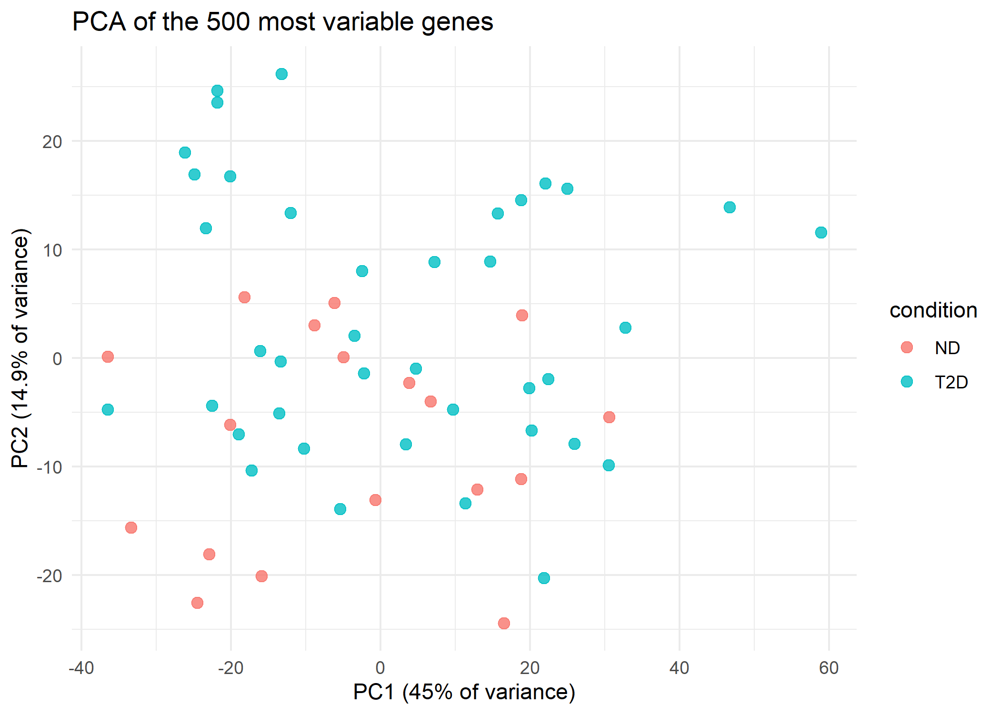
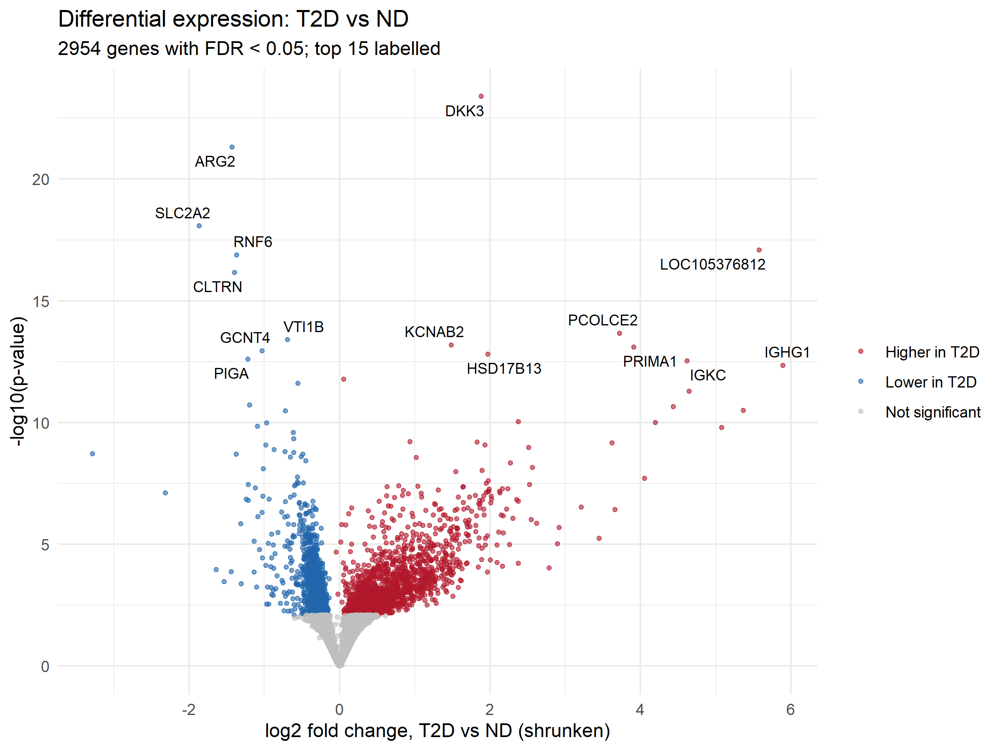
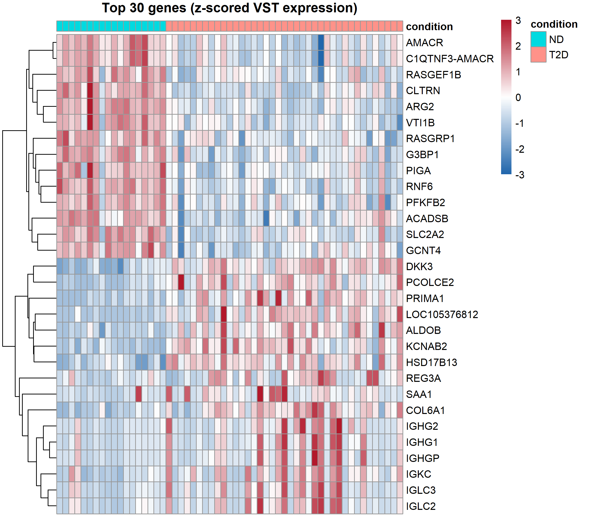

# Differential gene expression in pancreatic islets: type 2 diabetes vs non-diabetic donors

<!-- Replace everything in [square brackets] with your own results and words.
     Delete these comment lines when you're done. -->

A reproducible R/Bioconductor reanalysis of public RNA-seq data from human pancreatic islets, comparing donors with type 2 diabetes (T2D) to non-diabetic (ND) donors.

**Question:** Which genes are expressed at different levels in islets from people with type 2 diabetes compared with non-diabetic people?

**Tools:** R, Bioconductor (DESeq2, GEOquery, apeglm), ggplot2, pheatmap, Git/GitHub

## Data

- **Source:** NCBI GEO series [GSE164416](https://www.ncbi.nlm.nih.gov/geo/query/acc.cgi?acc=GSE164416), from Wigger L, Barovic M, Brunner AD, et al. *Multi-omics profiling of living human pancreatic islet donors reveals heterogeneous beta cell trajectories towards type 2 diabetes.* Nature Metabolism 3, 1017–1031 (2021). https://doi.org/10.1038/s42255-021-00420-9
- **Samples:** islets isolated by laser capture microdissection from pancreas tissue removed during surgery (partial pancreatectomy) in living patients.
- **Counts:** raw gene counts generated by NCBI's standard pipeline (alignment to GRCh38 and counting with featureCounts). I did not align reads myself.
- **Samples used:** [N] ND and [N] T2D. The dataset also contains [other groups, e.g. impaired glucose tolerance and type 3c diabetes], which I excluded to keep a clear two-group comparison. [Any other exclusions and why.] Full details are in `results/analysis_log.txt` and `results/tables/samples_used.csv`.

| | ND | T2D |
|---|---|---|
| Samples | [N] | [N] |
| [Sex, female/male] | [ ] | [ ] |
| [Age, mean (SD)] | [ ] | [ ] |

## Methods

1. **Data preparation** (`02_prepare_data.R`): matched sample information to count columns; kept genes with at least 10 reads in at least [N] samples ([N] of [N] genes kept).
2. **Quality checks** (`03_quality_checks.R`): library sizes; variance-stabilising transformation (VST); PCA of the 500 most variable genes; sample-to-sample distance heatmap. [What you found, e.g. "No samples were removed; two samples sat apart on PC2 but had normal library sizes, so I kept them."]
3. **Differential expression** (`04_differential_expression.R`): DESeq2 with design `[~ sex + age + condition]`. P-values were adjusted with the Benjamini–Hochberg method; genes with adjusted p < 0.05 are called significant. Log2 fold changes were shrunk with apeglm for ranking and plotting.
4. **Figures** (`05_figures.R`): p-value histogram, MA plot, volcano plot, heatmap of top genes, per-gene count plots.

## Results

[2–4 sentences in your own words. For example: how many genes were significant, how many higher vs lower in T2D, which genes stood out, and whether any match genes reported in earlier studies of T2D islets.]







Top genes: [`results/tables/top25_genes.csv`](results/tables/top25_genes.csv). All genes: [`results/tables/deseq2_results_all_genes.csv`](results/tables/deseq2_results_all_genes.csv).

## Limitations

<!-- Keep the ones you can explain, and add your own. -->

- **Bulk tissue:** each sample is a mix of cell types. T2D islets can contain fewer beta cells, so lower expression of a beta-cell gene may reflect fewer beta cells rather than less expression per cell.
- **Who the donors are:** samples come from patients having pancreatic surgery, often for pancreatic disease, which may affect the tissue and limits how far results generalise.
- **Cross-sectional:** the data show association at one time point; they can't show whether expression changes cause diabetes or result from it.
- **Group size:** the ND group is relatively small ([N]), which limits power.
- **Processing:** I used NCBI's standard counts rather than the authors' own pipeline, so results may differ from the paper.

## How to reproduce

Requires R (≥ 4.4) and an internet connection.

```r
# In RStudio, open t2d-islet-rnaseq.Rproj, then:
source("scripts/00_install_packages.R")   # once
source("scripts/run_all.R")               # downloads data and runs every step
```

The settings (dataset, groups, covariates, thresholds) are in `config.R`. Package versions are recorded in `docs/session_info.txt`.

## Project structure

```
config.R                  settings
scripts/                  analysis steps 00–05, run_all.R, helpers.R
data/                     downloaded and intermediate data (not in Git)
results/figures/          figures
results/tables/           results tables
results/analysis_log.txt  every filtering decision and summary number
docs/session_info.txt     R and package versions
```

## Acknowledgements

Analysis approach follows the DESeq2 vignette (Love, Huber & Anders, *Genome Biology* 2014) and the Bioconductor RNA-seq workflow. Data from Wigger et al. (2021) via NCBI GEO.

[Your name] · [LinkedIn] · [email]
